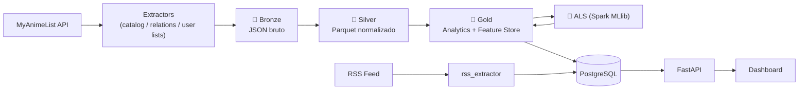

# 🧠 AniMind — Anime Data Platform


Plataforma de dados **end-to-end** sobre animes: coleta dados do MyAnimeList, processa em um **Data Lakehouse com arquitetura medalhão** (Bronze → Silver → Gold) usando **PySpark**, treina um **sistema de recomendação (ALS)** e serve tudo via **FastAPI + PostgreSQL** em um dashboard interativo.

## 🏗️ Arquitetura



## ✨ Destaques de Engenharia

- **Arquitetura medalhão** com PySpark: deduplicação por `updated_at`, normalização N:N (gêneros, estúdios) e agregações analíticas.
- **Feature Store** para ML: indexação de usuários (`StringIndexer`) e ratings implícitos inferidos a partir do status (completed / dropped / on-hold).
- **Recomendação "Discovery"** com ALS (filtragem colaborativa):
  - remove animes já assistidos (`left_anti` join);
  - bane franquias inteiras já conhecidas expandindo o grafo de relações em profundidade (sequel → sequel → ...);
  - recomenda apenas **pontos de entrada** (exclui obras com `prequel` / `parent_story`).
- **Serving layer**: tabelas Gold sincronizadas para o PostgreSQL (full overwrite) e expostas via FastAPI.
- **Tudo containerizado** com Docker Compose (API, banco, extratores e jobs Spark).

## 📁 Estrutura

```text
aniMind/
├── app/                    # Serving: FastAPI, modelos SQLAlchemy, dashboard (static/)
├── extractors/             # Ingestão de dados
│   ├── catalog_extractor/  # Catálogo de animes do MAL → Bronze
│   ├── relation_collector/ # Grafo de relações (sequel, prequel, ...) → Bronze
│   └── rss_extractor/      # Notícias via RSS → PostgreSQL
├── elt_spark/
│   ├── 01_bronze_to_silver/
│   ├── 02_silver_to_gold/
│   ├── 03_machine_learning/   # Treino ALS + geração de recomendações
│   ├── 04_gold_to_postgres/   # Carga da Gold no PostgreSQL
│   └── utils/
├── data_lake/              # bronze/ silver/ gold/ (dados não versionados)
├── docker-compose.yml
└── Dockerfile.*
```

## 🚀 Como executar

```bash
# 1. Configure as variáveis (Client ID do MyAnimeList)
cp .env.example .env

# 2. Suba o ecossistema
docker compose up -d --build

# 3. Rode o pipeline (exemplo manual)
python -m elt_spark.01_bronze_to_silver.process_catalog
python elt_spark/03_machine_learning/train_als_model.py
python elt_spark/04_gold_to_postgres/sync_gold.py
```

Acesse o dashboard em **http://localhost:8000** e a documentação da API em **http://localhost:8000/docs**.

## 📸 Screenshots

> _Adicione aqui prints do dashboard em `docs/`._