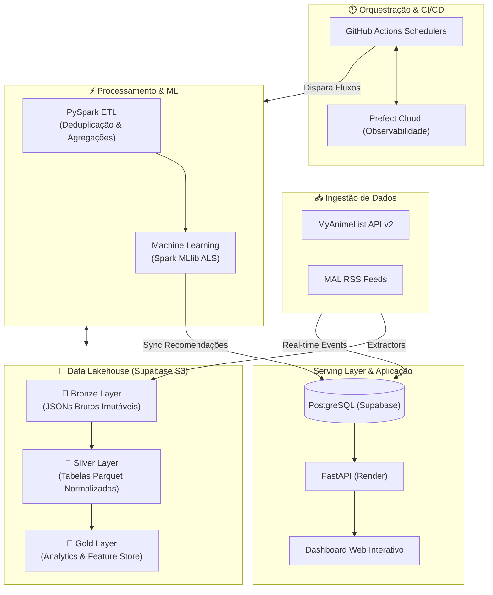
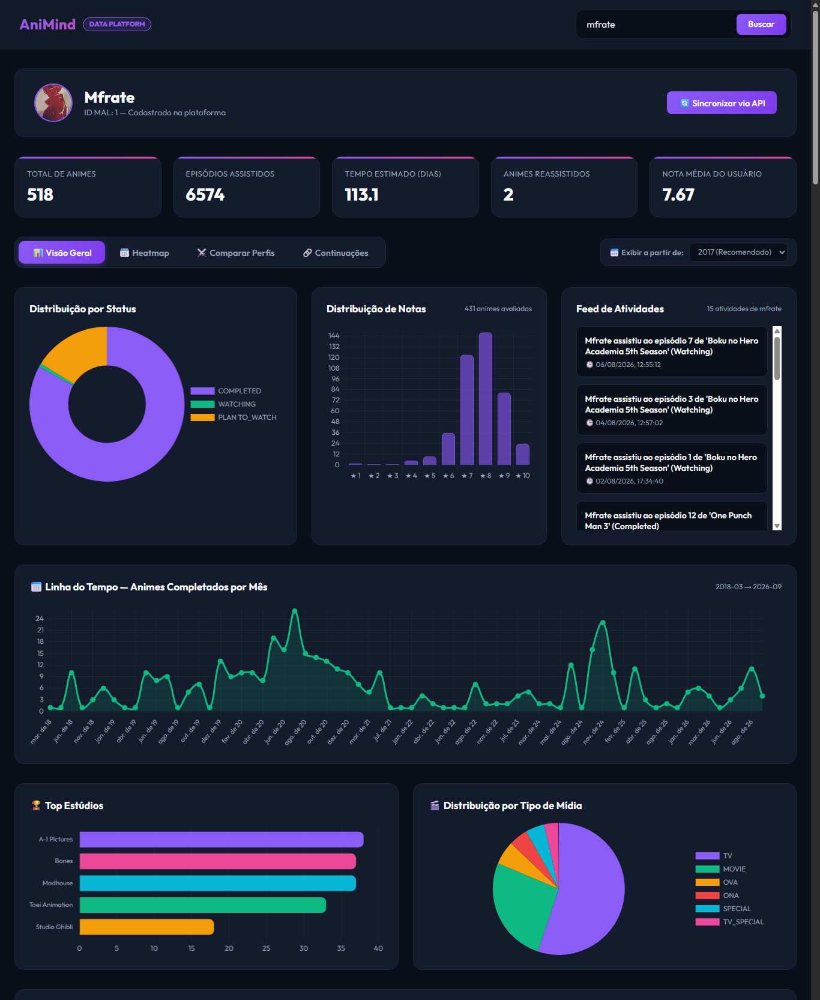
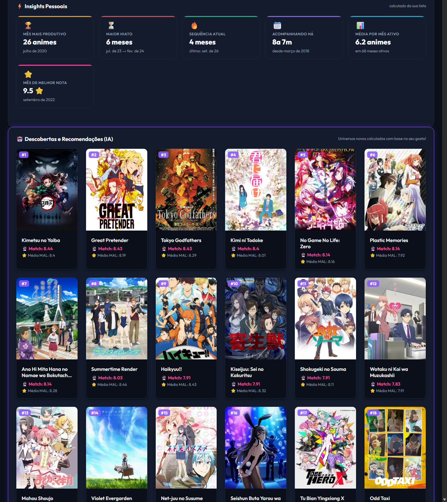

# 🧠 AniMind — Anime Data Platform

[](https://animind-s2s2.onrender.com)
[](https://animind-s2s2.onrender.com/docs)


Plataforma de dados **end-to-end** sobre animes: coleta dados oficiais do MyAnimeList, processa em um **Data Lakehouse com arquitetura medalhão** (Bronze → Silver → Gold) usando **PySpark**, treina um **sistema de recomendação por Filtragem Colaborativa (ALS)** e serve insights analíticos via **FastAPI + PostgreSQL** em um dashboard interativo.

Toda a infraestrutura opera com **custo zero (100% Free Tier)** através de uma arquitetura moderna distribuída em nuvem.

🔗 **Acesse online:** [Dashboard Web](https://animind-s2s2.onrender.com) | [Swagger API Docs](https://animind-s2s2.onrender.com/docs)

---

## 🏗️ Arquitetura do Sistema



---

## ✨ Destaques de Engenharia de Dados

- **Modern Data Stack Custo Zero:** Arquitetura distribuída 100% em nuvem utilizando GitHub Actions (runners Linux com 7 GB de RAM e Java 17 para Spark), Supabase (PostgreSQL e Storage S3), Render (serviço web FastAPI) e Prefect Cloud (observabilidade de pipelines).
- **Arquitetura Medalhão com PySpark:**
  - **Bronze:** Ingestão de cópias imutáveis em JSON (catálogo global, grafo de relações e bibliotecas de usuários).
  - **Silver:** Limpeza, deduplicação por `updated_at`, desaninhamento de estruturas complexas e normalização relacional em formato Snappy Parquet.
  - **Gold:** Tabelas analíticas otimizadas, métricas de engajamento por gênero/estúdio e construção da **Feature Store**.
- **Recomendação "Discovery" com Spark MLlib (ALS):**
  - Matriz de interação usuário-item com pesos implícitos inferidos pelo status de consumo.
  - Banimento em profundidade de franquias conhecidas através de travessia recursiva no grafo de relações (`sequel` → `prequel` → `side_story`).
  - Filtragem para recomendar estritamente **pontos de entrada** na franquia (exclui continuações diretas).
- **Serving Layer Resiliente:** Sincronização automatizada das tabelas analíticas Gold para o PostgreSQL com UPSERT (`ON CONFLICT`) para garantir integridade referencial com os dados transacionais de usuários.
- **Portabilidade Total:** O ecossistema pode ser executado de forma idêntica tanto na nuvem quanto localmente via Docker Compose ou scripts isolados.

---

## 📁 Estrutura do Repositório

```text
aniMind/
├── .github/workflows/       # Pipelines CI/CD agendadas no GitHub Actions
├── app/                     # Serving: FastAPI, modelos SQLAlchemy e dashboard
│   ├── api/v1/              # Endpoints REST (users, recommendations, news, auth)
│   ├── models/              # Modelos relacionais e schemas
│   ├── services/            # Serviços de integração com a API do MAL e OAuth
│   └── static/              # Dashboard Frontend interativo (HTML/CSS/JS)
├── data_lake/               # Armazenamento local do Lakehouse (bronze/ silver/ gold/)
├── elt_spark/               # Jobs de transformação e processamento PySpark
│   ├── 01_bronze_to_silver/ # Normalização e limpeza bruta -> Parquet
│   ├── 02_silver_to_gold/   # Métricas agregadas e Feature Store
│   ├── 03_machine_learning/ # Treinamento do modelo ALS e geração do Top 20
│   ├── 04_gold_to_postgres/ # Carga das tabelas Gold no PostgreSQL
│   └── utils/               # Configuração da SparkSession otimizada
├── extractors/              # Módulos de ingestão externa
│   ├── catalog_extractor/   # Extração paginada do ranking global MAL
│   ├── relation_collector/  # Mapeamento do grafo de continuações/relações
│   └── rss_extractor/       # Sincronização horária de notícias e atividades RSS
├── orchestration/           # Fluxos orquestrados Prefect e sync S3 Lakehouse
├── docker-compose.yml       # Orquestração de containers para execução local
├── Dockerfile.*             # Definições de containers (api, extratores, spark)
└── requirements.txt         # Dependências do projeto
```

---

## 🚀 Como Executar

### 1. Acesso Online (Produção)
A plataforma já está ativa e sincronizada na nuvem:
* **Dashboard Interativo:** [https://animind-s2s2.onrender.com](https://animind-s2s2.onrender.com)
* **Documentação Swagger:** [https://animind-s2s2.onrender.com/docs](https://animind-s2s2.onrender.com/docs)

### 2. Execução Local

```bash
# 1. Clone o repositório e configure as variáveis de ambiente
git clone https://github.com/MatheusFrate/AniMind.git
cd AniMind
cp .env.example .env

# 2. Suba o ambiente completo via Docker Compose
docker compose up -d --build

# 3. Ou execute o pipeline medalhão PySpark completo diretamente
python orchestration/animind_flow.py
```

Acesse localmente em **http://localhost:8000** (Dashboard) e **http://localhost:8000/docs** (Swagger).

---

## 📸 Screenshots

### 📊 Visão Geral & Estatísticas do Perfil (`mfrate`)


### 🤖 Motor de IA: Insights Pessoais & Recomendações (Top 20 Discovery)
